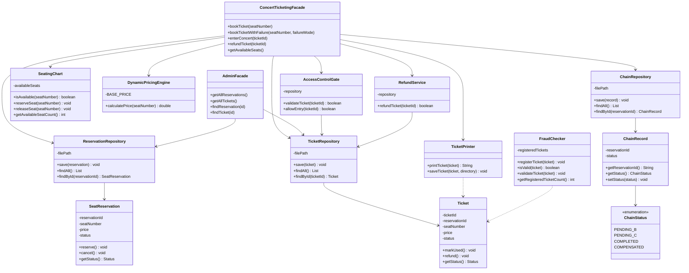

# Concert Ticketing System

## 1. Project Description

Concert Ticketing System is a Java application that demonstrates the **Facade Design Pattern**, a three-stage booking workflow, CSV persistence, failure compensation, and recovery after application restart.

The application manages concert seat reservations, ticket processing, ticket validation, concert entry, and refunds.

The system uses two facades to provide simple interfaces to multiple internal classes.

## 2. Technologies Used

- Java 19
- Maven
- JUnit 5
- JaCoCo 0.8.13
- CSV file persistence
- IntelliJ IDEA

## 3. Three Independent Subsystems

### Subsystem A - Reservation

Main classes:

- `SeatingChart`
- `DynamicPricingEngine`
- `SeatReservation`
- `ReservationRepository`

Responsibilities:

- Check available seats
- Calculate ticket prices
- Reserve seats
- Prevent double booking
- Save reservations in CSV files

### Subsystem B - Ticket Processing

Main classes:

- `Ticket`
- `TicketRepository`
- `TicketPrinter`
- `FraudChecker`

Responsibilities:

- Create tickets
- Save ticket information
- Print tickets
- Perform fraud checks
- Manage ticket statuses

### Subsystem C - Access Control

Main classes:

- `AccessControlGate`
- `RefundService`
- `AccessDemo`

Responsibilities:

- Validate tickets
- Allow concert entry
- Prevent repeated entry
- Reject refunded tickets
- Process refunds

## 4. Facade Design Pattern

The Facade Pattern provides a simplified interface to a complex subsystem.

This project contains two facades.

### ConcertTicketingFacade

This facade provides methods for:

- `bookTicket()`
- `bookTicketWithFailure()`
- `enterConcert()`
- `refundTicket()`
- `getAvailableSeats()`
- `getChains()`

It coordinates reservation, ticket processing, access control, and persistence.

### AdminFacade

This facade provides administrative operations:

- `getAllReservations()`
- `getAllTickets()`
- `findReservation()`
- `findTicket()`
- `getTotalReservations()`
- `getTotalTickets()`

It allows administrators to retrieve reservation and ticket information without directly interacting with repository implementations.

## 5. Three-Stage Workflow

The booking process follows three stages:

**A → B → C**

### Step A - Reservation

1. Check seat availability.
2. Calculate the ticket price.
3. Create and save a reservation.
4. Save the chain status as `PENDING_B`.

### Step B - Ticket Processing

1. Create a ticket.
2. Save the ticket in CSV storage.
3. Update the chain status to `PENDING_C`.

### Step C - Access Control

1. Validate the issued ticket using `AccessControlGate`.
2. Keep the ticket in the `ISSUED` status.
3. Save the printable ticket.
4. Update the chain status to `COMPLETED`.

The actual concert entry happens later through `enterConcert()`.

## 6. Persistence and Chain Statuses

The application uses CSV files to store reservations, tickets, and booking progress.

Main files:

- `reservations.csv`
- `tickets.csv`
- `chains.csv`

The workflow uses these statuses:


- `PENDING_B` - Reservation completed; ticket processing is pending.
- `PENDING_C` - Ticket processing completed; finalization is pending.
- `COMPLETED` - All booking stages completed.
- `COMPENSATED` - Failed booking was rolled back.
## 7. Failure Simulation and Compensation

The system supports simulated failures at steps B and C.

### Failure at Step B

The reservation has already been saved, but ticket processing fails.

The system cancels the reservation, releases the seat, and saves `COMPENSATED`.

### Failure at Step C

The reservation and ticket have already been saved, but final validation fails.

The system compensates in reverse order:

1. Refund the issued ticket.
2. Cancel the reservation.
3. Release the seat.
4. Save the chain status as `COMPENSATED`.

This prevents an unsuccessful booking from leaving an active reservation and an issued ticket.

## 8. Recovery After Restart

The application stores workflow progress in `chains.csv`.

When `ConcertTicketingFacade` starts, it loads saved reservations and restores occupied seats.

It then checks unfinished chains with statuses `PENDING_B` or `PENDING_C`.

For these chains, it compensates saved tickets and reservations and changes the chain status to `COMPENSATED`.

This allows the application to recover from interrupted booking operations.

## 9. Principle of Least Knowledge

The Principle of Least Knowledge, also called the Law of Demeter, recommends limiting how much one object knows about other objects.

### Before Facade

Without a facade, client code would need to work directly with several classes:


```java
SeatingChart chart = new SeatingChart();
DynamicPricingEngine pricing = new DynamicPricingEngine();
ReservationRepository reservations =
        new ReservationRepository(dataDirectory.resolve("reservations.csv"));
TicketRepository tickets =
        new TicketRepository(dataDirectory.resolve("tickets.csv"));
AccessControlGate gate = new AccessControlGate(tickets);
```

The client would also need to coordinate operations and handle errors.

### After Facade

The client can use one simple method:

```java
ConcertTicketingFacade facade =
        new ConcertTicketingFacade(dataDirectory);

Ticket ticket = facade.bookTicket("A5");
```

The facade hides the coordination between subsystems.

This reduces coupling and makes client code easier to understand and maintain.

## 10. Facade vs Adapter - Reflection

Facade and Adapter are structural design patterns, but they solve different problems.

The **Facade Pattern** provides a simplified interface to a group of existing classes. It reduces complexity for client code and coordinates operations across subsystems.

The **Adapter Pattern** converts one interface into another interface expected by a client. It is useful when two components have incompatible interfaces.

In this project, Facade is appropriate because booking requires several operations across reservation, ticket processing, and access control. The problem is not incompatible interfaces; it is the complexity of coordinating multiple classes.

`ConcertTicketingFacade` simplifies booking, entry, refunds, and recovery. `AdminFacade` simplifies administrative access to stored information.

Therefore, Facade improves usability and reduces dependencies between clients and subsystem implementations.

## 11. Testing and Code Coverage

The project uses JUnit 5 for automated testing and JaCoCo for coverage analysis.

Verified test results:

- Total tests: **74**
- Passed: **74**
- Failures: **0**
- Errors: **0**
- Minimum required line coverage: **80%**
- JaCoCo coverage check: **Passed**

The measured line coverage before the final Access Control adjustment was approximately **81.9%**. The subsequent Maven verification also passed the configured 80% coverage rule.

Tests cover reservations, ticket processing, refunds, access control, persistence, failure compensation, recovery, and facade operations.

## 12. How to Run

Requirements:

- JDK 19
- Maven 3.x

To run the console application, open `src/main/java/com/concertticketing/app/Main.java` in IntelliJ IDEA and run its `main()` method.

The application provides options for booking tickets, concert entry, refunds, viewing available seats, simulating failures, and viewing chain statuses.

## 13. How to Run Tests and Coverage

Run the following Maven command:

```bash
mvn clean verify
```

This command compiles the application, runs JUnit tests, generates the JaCoCo report, and checks the minimum 80% line coverage requirement.

The HTML coverage report is generated at:

```text
target/site/jacoco/index.html
```

On the development Windows computer, Maven was run using IntelliJ IDEA's bundled Maven installation with a custom local repository and JaCoCo data-file path to avoid local environment issues.



## 15. Conclusion

Concert Ticketing System demonstrates the Facade Design Pattern, separation of responsibilities, persistent data storage, coordinated booking operations, failure compensation, recovery after restart, and automated testing.

The two facades simplify interaction with the internal subsystems and make the application easier to use and maintain.

## 16. Assignment 5 — Strategy Design Pattern

### Overview

Assignment 5 introduces interchangeable algorithms for concert ticket pricing and seat selection. Both algorithm families use the Strategy pattern, allowing the application to replace behavior at runtime without rewriting its context classes.

### Strategy classes and responsibilities (SRP)

| Class | Responsibility |
| --- | --- |
| `PricingStrategy` | Defines the contract for ticket price calculation. |
| `RegularPricingStrategy` | Returns the standard ticket price. |
| `EarlyBirdPricingStrategy` | Applies advance-purchase pricing based on days before the concert. |
| `DemandPricingStrategy` | Calculates prices using demand supplied by an external data abstraction. |
| `PricingContext` | Delegates price calculation to a replaceable pricing strategy. |
| `PricingSelector` | Selects a pricing algorithm using purchase timing plus demand conditions. |
| `DemandDataSource` | Defines a contract for retrieving demand measurements. |
| `SimulatedDemandDataSource` | Supplies simulated demand measurements for local execution. |
| `OldPricingCalculator` | Preserves the original conditional pricing implementation for refactoring comparison. |
| `SeatSelectionStrategy` | Defines the contract for selecting an available concert seat. |
| `CheapestSeatStrategy` | Selects a seat according to the cheapest-seat ordering rule. |
| `ClosestSeatStrategy` | Selects a seat according to the closest-seat ordering rule. |
| `BalancedSeatStrategy` | Selects the middle seat from a sorted availability list. |
| `SeatSelectionContext` | Delegates seat selection to a replaceable seat strategy. |
| `SeatSelectionSelector` | Chooses a seat algorithm from a customer preference. |
| `StrategyDemo` | Demonstrates pricing, seat selection, automatic selection, runtime replacement. |

### Why Strategy instead of State or Template Method?

Strategy is appropriate because concert ticket prices and seat choices can be calculated using different algorithms. Each algorithm implements a common interface. The client or selector chooses an implementation, while the context delegates work to it. For example, regular pricing returns the base price, early-bird pricing considers how far in advance the ticket is purchased, and demand pricing responds to demand data. These are alternatives for the same operation, not steps in one fixed workflow.

The State pattern is different. It models an object whose behavior changes according to its internal lifecycle state, often with transitions between states. In this application, pricing algorithms are selected according to business rules or user choice rather than lifecycle transitions. A pricing strategy does not represent a ticket moving from issued to used or refunded.

Template Method is also different. It defines the overall algorithm in a base class, leaving selected steps for subclasses to override. Our pricing and seat selection implementations do not share one inherited algorithm skeleton. Instead, independent classes implement small interfaces. This avoids forcing unrelated algorithms into a class hierarchy.

Strategy therefore supports runtime replacement, separation of responsibilities, and extension through new implementations. Context classes need only the interface, while selectors contain the rules for choosing a concrete strategy. This helps follow the Open/Closed Principle: a new algorithm can be added as a new implementation, with selection rules updated separately when automatic selection is needed.

### External data isolation

`DemandPricingStrategy` depends on the `DemandDataSource` interface rather than directly reading a live external service. `SimulatedDemandDataSource` provides local data. Tests can substitute a fake implementation returning fixed demand values, making results deterministic.

### Testing

JUnit 5 tests cover pricing strategies, seat selection strategies, runtime replacement, selector behavior, plus invalid or empty inputs. `PricingStrategyTest` includes parameterized coverage. Earlier individual runs showed 5 passing legacy pricing tests, 9 passing pricing strategy tests, plus 8 passing seat strategy tests. These are individual test-run observations, not a verified count for the complete project after the final changes.

Run all tests from the project root:

```bash
mvn test
```

### Demo

Run `com.concertticketing.app.StrategyDemo` in IntelliJ IDEA. It demonstrates pricing results for multiple algorithms, manual switching, automatic pricing selection, plus seat selection algorithms.

### Refactoring history

The initial implementation placed pricing variants in `OldPricingCalculator` using conditional logic. A separate commit saved this implementation with its JUnit tests. Later commits introduced the Strategy interfaces, concrete implementations, contexts, selectors, plus tests.

**Before refactoring commit:** https://github.com/gauarmuhamet-dot/ConcertTicketing-/commit/a803e180b041b79c45a42d566f94fadfc231aafe

**After refactoring commit:** https://github.com/gauarmuhamet-dot/ConcertTicketing-/commit/424c60b8f28e5fa45c84f45bf49cfc1f52ca410b

The same legacy pricing tests should be run at both revisions to verify behavior remains unchanged.
